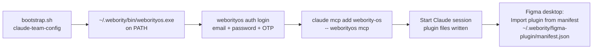
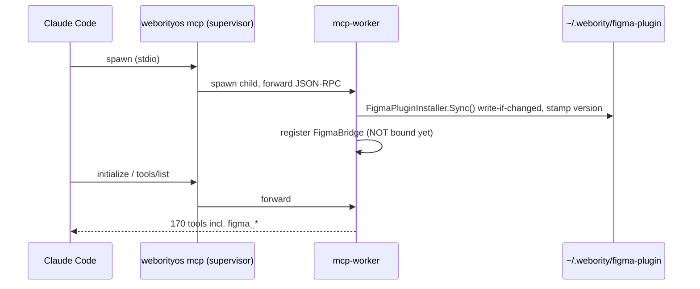
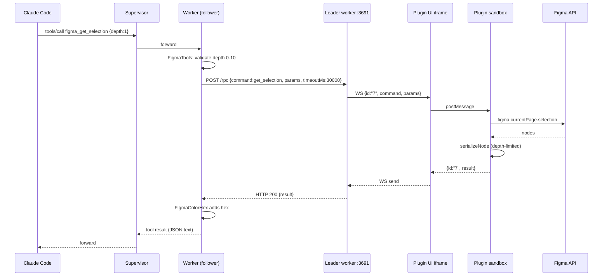
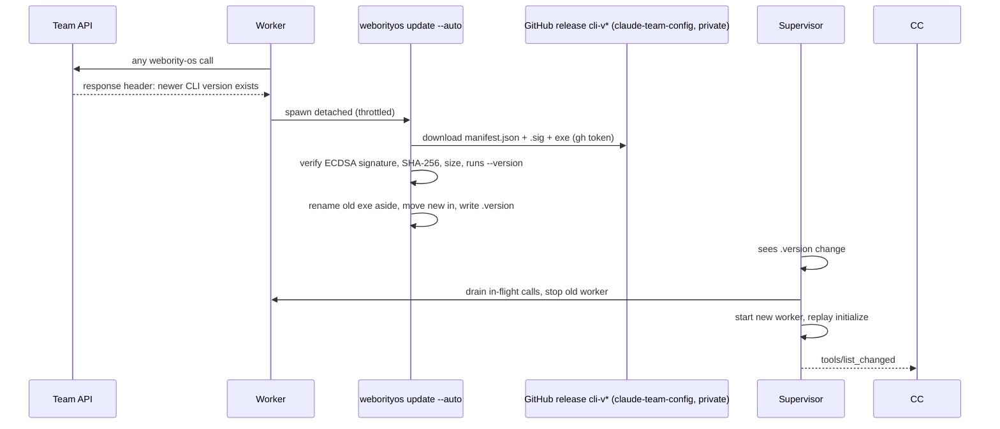

# Webority Figma MCP: End-to-End Flow, Process and Setup

Analysed 15-Sep-2026 from `Webority/webority-os` (development) source plus live checks on this machine. CLI v0.3.21.
Companion files: `ANALYSIS.md` (code findings), `README.md` (plugin notes), `source/` (code copies).

## Summary

The Figma tools are not a separate product. They ride inside the **weborityos CLI**, which Claude Code starts as its `webority-os` MCP server. The chain is: **Claude Code → `weborityos mcp` (supervisor) → `weborityos mcp-worker` (real server) → FigmaBridge on port 3691 → plugin UI iframe → plugin sandbox → Figma API**. Setup is three one-time steps (install CLI, log in, import the plugin manifest). After that the CLI updates itself from signed GitHub releases, rewrites the plugin files on every start, and hot-swaps running sessions without breaking them. Design data only moves on your PC until it reaches Claude.

---

## 1. The pieces

| # | Piece | Where it lives | Job |
|---|---|---|---|
| 1 | **Claude Code** | your terminal / VS Code | Calls `figma_*` tools over MCP (stdio) |
| 2 | **Supervisor** `weborityos mcp` | `~/.webority/bin/weborityos.exe` | Owns Claude's stdio pipe for the whole session; restarts or swaps the worker |
| 3 | **Worker** `weborityos mcp-worker` | same exe, child process | The actual MCP server: ~170 tools incl. 12 `figma_*` |
| 4 | **FigmaPluginInstaller** | inside worker | Writes plugin files to `~/.webority/figma-plugin/` on start |
| 5 | **FigmaBridge** | inside worker | Port 3691: leader/follower election, WebSocket + `/ping` + `/rpc` |
| 6 | **Plugin UI** `dist/index.html` | iframe inside Figma desktop | Holds the WebSocket (the sandbox has no network) |
| 7 | **Plugin sandbox** `dist/code.js` | Figma desktop | Runs `figma.*` API calls, serialises results |
| 8 | **Figma file** | Figma cloud, rendered by desktop app | The design being read |

---

## 2. One-time setup (per machine)



| Step | Command / action | Result | This machine |
|---|---|---|---|
| 1. Install CLI | `bootstrap.sh` (team config) | `~/.webority/bin/weborityos.exe`, `.version` marker | ✅ v0.3.21 |
| 2. Log in | `weborityos auth login` | Token in `~/.webority/config.json` (valid 30 days, refreshes) | ✅ ramshankar.thakur@webority.com, valid to 15-Oct-2026 |
| 3. Register MCP | `claude mcp add webority-os -- weborityos mcp` | stdio server in `~/.claude.json` | ✅ `webority-os` registered |
| 4. Plugin files | automatic on first MCP start | `~/.webority/figma-plugin/{manifest.json,dist/}` | ✅ present, matches repo |
| 5. Import plugin | Figma desktop → Plugins → Development → Import plugin from manifest | Plugin listed under Development | ✅ done today |

**Import only from `~/.webority/figma-plugin/manifest.json`**, never from a repo checkout or the `C:\Dev` copy. That path is the one the CLI keeps current.

**Needs:** Figma **desktop** app (dev plugins do not run in the browser), `gh` logged in (for updates, private release repo).

---

## 3. Every Claude session start



- The bridge **does not bind port 3691 yet**. Sessions that never use Figma never touch the port.
- `ParentWatcher`: if Claude Code dies, supervisor and worker exit too.
- Sync is best-effort: if writing plugin files fails, the server still starts.

---

## 4. Opening the plugin in Figma

1. Right-click canvas → Plugins → Development → **Webority Figma MCP (weborityos CLI)**.
2. Figma loads `dist/code.js` (sandbox) and `dist/index.html` (300×170 panel) fresh from disk.
3. UI opens `ws://localhost:3691`:
   - **Bridge up** → WebSocket upgrade → sends `{hello:true, version:"0.3.21"}` → green "Connected".
   - **Bridge not up** (no session has made a figma call yet) → red "Bridge server not reachable", retries every 2 s.
4. Bridge stores this socket as **the** plugin connection. A newer connection replaces it.

---

## 5. First `figma_*` call: election

```mermaid
flowchart TD
  A[figma_* call in worker] --> B{Bind 127.0.0.1:3691}
  B -- fails --> F[FOLLOWER<br/>relay via HTTP /rpc to leader]
  B -- ok --> C{Bind [::1]:3691}
  C -- fails --> G[FOLLOWER<br/>IPv6 port held by other app]
  C -- ok --> L[LEADER<br/>accept plugin WebSocket,<br/>serve /ping + /rpc]
```

- One leader per machine. All other sessions are followers.
- **This machine now:** 2 Claude sessions = 2 supervisor/worker pairs. Worker **PID 9552** (this session, started 11:33) is the leader. Worker 24008 (other session, 11:00) is a follower.

---

## 6. One tool call, end to end

Example: `figma_get_selection` from a follower session.



- On the leader session the `/rpc` hop is skipped: the worker talks to the WebSocket directly.
- **Timeouts:** send 5 s; reply 30 s (metadata, node, selection, styles, variables) or 60 s (document, find, text, exports, images); follower HTTP adds 5 s.
- **Screenshots:** plugin returns base64 → `figma_get_screenshot` returns an image block (SVG as text) → `figma_save_screenshot` / `figma_save_image` write the file on your disk.
- **Errors:** any exception becomes a clean error result (`McpToolErrorBoundary`). A second identical failure adds a hint inviting `file_mcp_bug` (not used here, per your instruction).

---

## 7. Auto-update and hot swap



**What this means for Figma:**
- The new worker runs `Sync()` → new plugin files on disk → Figma picks them up **next time you run the plugin** (no re-import).
- If the swapped worker was the **leader**, port 3691 is released. The plugin shows "Disconnected, retrying". The next `figma_*` call from any session re-elects a leader and the plugin reconnects within ~2 s. The first call may fail with "leader changed, retry".
- A plugin left open across an update keeps running the **old** code until you close and reopen it. `figma_status` warns when plugin and CLI versions differ.
- Leftovers: `weborityos.exe.old-<timestamp>` asides are swept on later runs once nothing uses them (one 41 MB aside is still on this machine).

---

## 8. Where data goes

| Data | Path | Leaves your PC? |
|---|---|---|
| Figma file content | Figma cloud → Figma desktop | Already in Figma cloud |
| Tool commands + results | Claude Code ↔ supervisor ↔ worker ↔ 127.0.0.1:3691 ↔ plugin | **No**, loopback only |
| Results shown to Claude | Claude Code → Anthropic | **Yes**, it is how Claude reads them |
| Saved screenshots / images | worker → path you give | No, local disk |
| Telemetry (App Insights) | worker → Webority prod App Insights | **Off by default**, and not set on this machine. Even when on: call shape only, no values. Figma calls are not HTTP, so they are not counted as usage. |
| Friction log (failed calls) | worker memory | Only if an agent files `file_mcp_bug` (disabled by your instruction) |
| Webority API | worker → Team API | Only for non-Figma tools (tasks, bugs) and update checks |

---

## 9. Failure modes and fixes

| Symptom | Cause | Fix |
|---|---|---|
| `figma_status`: "no Figma plugin is connected" | Plugin not running in Figma desktop | Run the plugin; keep the panel open |
| Plugin panel red: "Bridge server not reachable on port 3691" | No session has made a figma call yet, or leader just exited | Ask Claude to run `figma_status` (it binds the port); plugin reconnects in 2 s |
| "The Figma bridge leader changed ... Retry the call." | Leader session closed or hot-swapped | Retry once |
| "Figma bridge leader is unreachable" | Leader busy past timeout, or port race | Retry; check `figma_status` |
| "Timed out after 30000ms / 60000ms" | Huge page, deep tree, large export, or Figma frozen | Use `figma_find_nodes` + smaller scope, lower depth or scale |
| "Unknown command ... older build" / version warning in `figma_status` | Stale plugin copy (old import or open across update) | Close and reopen plugin; if it persists remove all "Webority Figma MCP" dev entries and re-import `~/.webority/figma-plugin/manifest.json` |
| Reads show the **wrong file** | Plugin open in two files; latest connection wins | Keep the plugin open in one file; confirm file name in `figma_status` |
| "follower, port 3691 IPv6 loopback is held by an unrelated process" | Another app uses port 3691 on `::1` | Close that app; no session can lead until it does |
| `figma_save_*` error writing file | Target folder does not exist | Create the folder first |
| `figma_get_styles` / variables look empty | Styles/variables come from a team library | Only local ones are returned; use official Figma MCP `get_variable_defs` |
| No `figma_*` tools at all | `webority-os` MCP not registered, logged out, or failed to start | `claude mcp list`, `weborityos auth login`, run `doctor` tool |

---

## 10. Health check sequence

1. `doctor` (webority-os): running vs installed version, `updatePending`, auth valid.
2. `figma_status`: leader/follower, plugin connected, plugin vs CLI version, open file name.
3. `figma_get_metadata`: confirms reads actually work.

**This machine, 15-Sep-2026 11:4x IST:** doctor ✅ 0.3.21 up to date, authenticated · figma_status ✅ connected, leader, plugin 0.3.21 = CLI 0.3.21, file **Capnix** (12 pages).

---

## 11. Process weak spots (from the flow)

1. **Nothing binds 3691 until a figma call.** Opening the plugin first shows red until Claude makes any figma call. Confusing on first use.
2. **Leader tied to one session.** Closing or hot-swapping the leader session interrupts every other session's Figma reads for one call.
3. **Updates don't reach an open plugin.** The plugin must be reopened to load new code.
4. **Multiple Figma windows.** The newest plugin connection silently takes over.
5. **No access check on port 3691** (see `ANALYSIS.md` findings 1-2).
6. **Desktop only.** Needs Figma desktop plus an open panel; the official Figma MCP works from a link instead.
